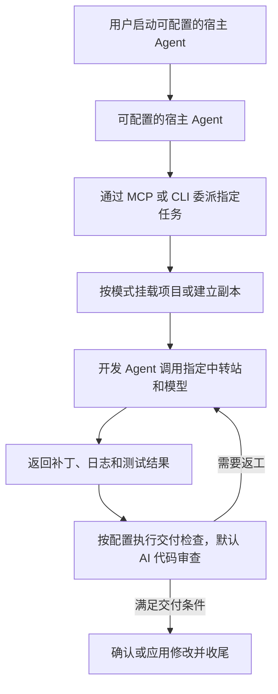

# 中转沙箱（relay-sandbox）

中转沙箱的目标是：在宿主机正常使用可信接口的宿主 Agent（默认 Codex，可选 Claude Code、OpenCode），把指定开发任务交给隔离环境中的中转站模型，完成后由宿主机按配置检查、返工或收尾。宿主与内层开发 Agent 均可独立配置，默认 Codex；默认启用宿主 AI 代码审查，可增加测试或关闭代码审查；隔离模式下，全部交付检查关闭时直接应用，并注明未执行检查。

项目正在实现。已提供 TypeScript CLI、带能力发现与有界等待的 stdio MCP、Docker 开发环境、独立 Agent 配置、默认直接挂载、宿主可配置的隔离副本、可配置检查、三方合并和受控应用。真实 Docker 基本隔离、三种开发 Agent 假中转站闭环、DeepSeek 真实模型代码交付及基础监督恢复已验证；Codex 宿主已验证拒绝恶意代码、正常交付及审计提醒的最终用户上报；独立宿主指标采集、轮转和到期清理已接入；部分内核审计已接入，宿主冻结授权、IPv4任务隔离、资源模式、默认关闭诱饵和指定工具流量观察已通过本包验收及独立双审。任意拓扑/协议、完整审计覆盖、稳定化全故障矩阵及第三方代理中转站专项联调仍未完成。

先阅读[运行说明](devdocs/usage.md)，再执行 `pnpm install --frozen-lockfile && pnpm build`。当前是 CLI/MCP 工具，没有网站服务。完整验收范围见[实现验证记录](devdocs/implementation-validation.md)。

新任务主项目默认直接读写挂载。可由宿主选择 `isolated` 使用隔离副本；直接模式中，修改立即生效，检查成为事后检查，审核拒绝不自动回滚。操作见[项目访问方式](devdocs/project-access.md)。

## 按任务查阅文档

| 任务 | 文档 |
| --- | --- |
| 安装、配置、运行与排障 | [运行说明](devdocs/usage.md) |
| 让 AI 配置中转站或生成私有配置模板 | [中转配置](devdocs/relay-setup.md) |
| 选择默认直接挂载或隔离副本 | [项目访问方式](devdocs/project-access.md) |
| 配置宿主授权、资源共享及可选诱饵 | [行为策略](devdocs/behavior-policy.md) |
| 查看实际测试与剩余缺口 | [实现验证记录](devdocs/implementation-validation.md) |
| 回溯资源指标、设置轮转及到期清理 | [指标与清理](devdocs/observability.md) |
| 查看异常上报和用户输出验证 | [异常上报](devdocs/user-reporting.md) |
| 提交审核 JSON、验证恶意代码拦截 | [结构化审核](devdocs/review.md) |
| 按步骤开发，记录进度并审核 | [开发任务](.tasks/2026-11-02-relay-sandbox-development.md) |
| 查看模块、配置、流程、阶段及验收方案 | [开发方案](devdocs/development-plan.md) |
| 确认使用流程、保护目标和必需能力 | [需求](devdocs/requirements.md) |
| 了解信任边界和待验证的执行方案 | [架构草案](devdocs/architecture.md) |
| 选择试配路线，对照 R01–R10 和安全默认值 | [需求对照表](references/capability-matrix.md) |
| 深入查看 11 个仓库的特性、限制和验证项 | [项目调研](references/projects.md) |
| 追溯官方资料、原帖和固定版本代码 | [资料索引](references/sources.md) |
| 试配方案并记录验收结果 | [验证计划](devdocs/validation.md) |
| 核对已明确的要求和未决定的选择 | [决策与待确认事项](devdocs/decisions.md) |
| 查找目录用途和文档位置 | [项目结构](devdocs/structure.md) |
| 编写或更新文档 | [文档写作规范](devdocs/writing.md)、[协作规范](AGENTS.md) |

## 目标流程

## 按开发方案推进

1. 阅读[开发方案](devdocs/development-plan.md)，区分已确认需求与建议设计。
2. 首先跑通项目副本、Docker 内开发 Agent、检查和应用的核心流程，保留基本隔离及停止清理能力。
3. 按 P0–P5 分阶段实现，中断恢复等放到最后，记录各阶段验收证据；若要求独立内核，重新评估 BoxLite。
4. 复用成熟运行时与 Agent，只有实际存在缺口时增加封装。

MCP 或 CLI 负责委派，运行时与宿主机策略负责隔离。验证范围应覆盖开发 Agent 的全部工具入口，以及文件交付和结果审核。

安装、检查和构建命令见运行说明。网站重启不适用。

新任务默认允许外部内网，宿主与其他任务默认拒绝。额外目录权限由宿主独立配置并冻结；直接可写授权会即时影响宿主。诱饵默认关闭，开启后的流量观察仅覆盖明确验证的工具组合。命中和覆盖缺口用于收尾提醒，不替代交付代码审核；当前验收进度见[行为策略任务包](.rope/issues/behavior-policy/tasks.md)。

新任务默认保留并复用项目环境，任务完成后停止。可选择限期保留或临时销毁；任务清理与环境删除分开。配置和操作见[持久环境](devdocs/persistent-environments.md)。
