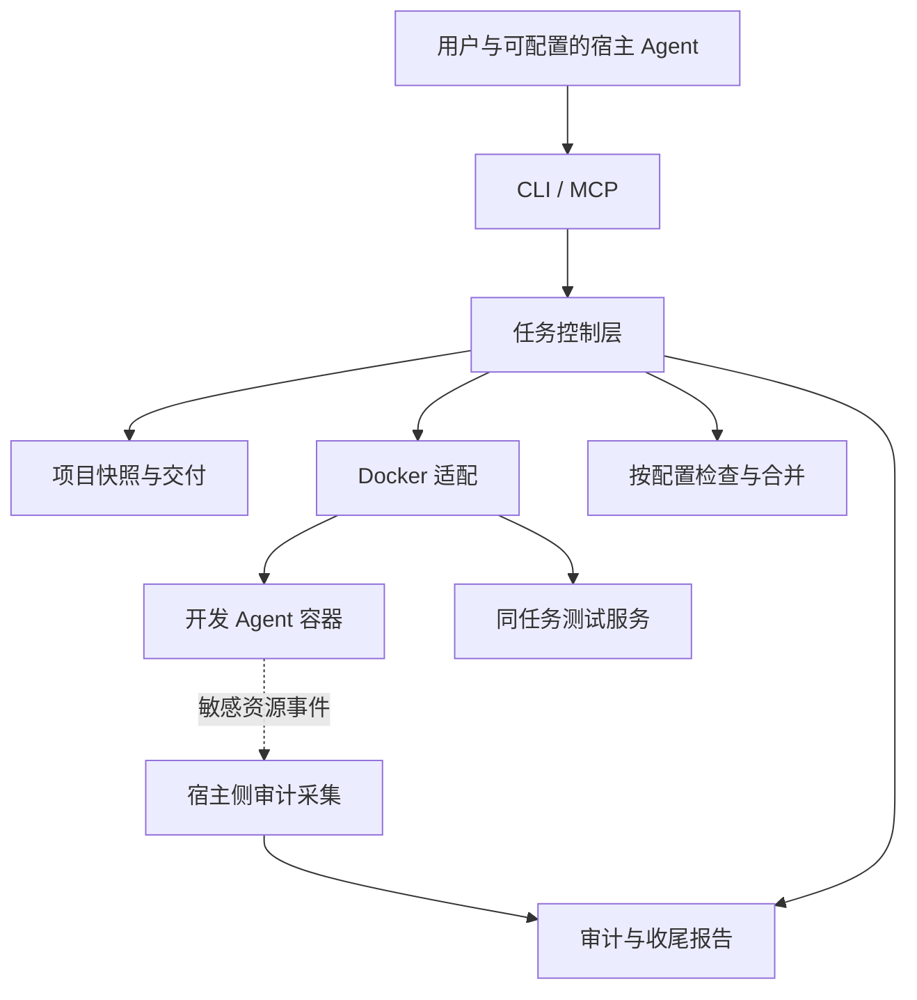

# 中转沙箱开发方案

状态：2026-11-02 编写。项目中文名已确认。本文以直接封装 Docker 为首选设计，尚未实现或实测；技术细节是开发建议，不替代已确认的 [D1–D20 需求](decisions.md)。本轮只编写方案。

执行时使用[结构化开发任务](../.tasks/2026-11-02-relay-sandbox-development.md)，逐项更新状态、审核和进度日志。新增逻辑按职责拆分文件，避免继续堆入大文件；函数和关键步骤必须有中文注释。整个开发任务完成后必须更新 `devdocs/` 功能文档。

## 确定首版范围

首版面向单用户 Linux 开发主机。用户仍在项目目录中使用可信接口的宿主 Agent（默认 Codex，可选 Claude Code、OpenCode），通过受限 CLI 或 MCP 委派任务。中转沙箱负责准备副本、运行内层 Agent、交付检查、应用结果、审计和清理。

首版直接使用 Docker Engine API，不实现容器运行时，不开发模型工具循环，不引入 Kubernetes、远程调度、资源池或 Web 管理后台。后续若要求独立内核，重新评估 BoxLite；不把容器称为具有独立内核的虚拟机。

建议使用 TypeScript、Node.js 当前受支持的 LTS 和 pnpm，便于编写 CLI、MCP、配置校验与任务流程。Docker 调用采用成熟客户端并固定版本；客户端库及 MCP SDK 在实现前核对维护状态和协议兼容性。宿主审计采集若需要原生能力，使用独立的小型辅助程序，不在业务层重写内核机制。

## 选择语言和开发工具

状态：以下为选型建议，尚未由用户定案，不据此安装依赖。

| 用途 | 建议 | 原因 |
| --- | --- | --- |
| 主要语言 | TypeScript，开启 strict | 配置、任务状态、工具输入与 Agent 适配共用类型 |
| 运行时和包管理 | Node.js 受支持 LTS、pnpm | CLI、子进程和文件流符合当前工作负载，沿用项目检查约定 |
| 应用结构 | 单包、按模块组织，CLI/MCP 共用核心服务 | 快速开发，先不引入 Web 框架、微服务或复杂依赖注入 |
| CLI | Commander | 复用参数解析、子命令与帮助输出 |
| MCP | 官方 TypeScript SDK，先 stdio | 同一套任务操作适配不同宿主 Agent |
| Docker | dockerode 候选客户端 | 复用 Engine API 和流处理；它是社区库，不是 Docker 官方 SDK，需验证并固定版本 |
| 配置校验 | Zod，加成熟 YAML 解析库 | 同时校验文件及工具输入，返回清晰错误 |
| 首版存储 | JSON 元数据、JSONL 事件及制品目录 | 单用户试用期减少数据库集成；稳定化阶段再评估 SQLite |
| 测试和质量 | Vitest、tsc、ESLint，pnpm scripts | 分开做类型检查、单元测试与真实 Docker 集成验证 |
| 底层采集 | 优先接入现成审计工具，确有缺口再写辅助程序 | 避免首版引入多语言；必要时按所选内核接口决定 Go、Rust 或 C |

TypeScript 的选择来自快速开发与任务编排需求，不代表其他语言不能实现。Go 是主要替代：Docker 有官方 Go SDK，适合单文件分发及长期运行服务；若项目转向大量系统控制或单二进制交付，应重新比较。Python 同样有官方 Docker SDK 和 MCP SDK，但目前没有必须依赖 Python AI 库的需求。Rust 暂不作为主语言，除非原生安全辅助程序成为主要工作量。

两侧 Agent 都通过适配层调用现成程序，不导入某个 Agent 专属 SDK 作为系统核心。宿主适配提供接入说明、工具调用及审查结论交接；内层适配提供启动参数、配置生成、输出解析和可用会话能力。CLI 版本、协议及能力分别验证，不把多个工具的恢复功能假定为一致。

官方依据：[MCP SDK](https://modelcontextprotocol.io/docs/sdk)、[Node.js 发布支持](https://nodejs.org/en/about/previous-releases)、[Docker API 与官方 SDK](https://docs.docker.com/reference/api/engine/)。组件资料：[Commander](https://github.com/tj/commander.js)、[dockerode](https://github.com/apocas/dockerode)、[Zod](https://zod.dev/)、[Vitest](https://vitest.dev/guide/)。实施时再核对并固定兼容版本。

## 保持实现可维护

编码规则、文件长度及进度维护以[任务文档第 3、5 节](../.tasks/2026-11-02-relay-sandbox-development.md)为准，避免两份文档重复维护阈值。

模块使用明确的数据契约，不把整个可变任务对象层层传递：

| 契约 | 内容 | 生产者 → 消费者 |
| --- | --- | --- |
| Manifest | 路径、类型、模式和摘要 | 工作区 → 差异与合并 |
| ChangeSet | 新增、修改、删除及模式变化 | 差异计算 → 审查与合并 |
| CheckResult | 检查项、状态、产物摘要与证据 | 检查器 → 交付策略 |
| ReviewDecision | 宿主结论、产物与配置摘要 | 宿主接入 → 交付策略 |
| ApplyPlan | 最终变更、预期原文件摘要及检查关联 | 合并与交付策略 → 应用器 |

用 `baselineManifest`、`resultManifest`、`currentManifest` 命名三方输入。合并只生成候选结果，检查只执行配置要求，应用器只执行已放行的 ApplyPlan；由任务用例组织流程，三者不相互递归调用。状态和结果使用可辨别联合类型表达合法情况，不用大量可选字段表达互斥状态。

宿主与开发 Agent 使用不同契约：`agents/host/contract.ts` 管接入和审查交接，`agents/development/contract.ts` 管配置生成、启动和输出解析。只共享真实公共的数据类型；按工具增加具体适配文件，不建立通用插件注册系统或泛型基类。

## 错误处理与重试

- 配置错误、路径校验失败、权限不足和不支持的能力立即报错；保留原始原因，不套自动修复或默认配置。
- 仅被明确分类为临时性的故障允许有限重试，限定次数、超时和操作范围；有副作用的写入或应用不自动重放。
- 测试失败是检查结果，由任务流程决定有限返工；不等同网络异常重试，也不在每一层嵌套重试。
- 只在补充上下文、释放资源或转换入口输出时捕获异常。包装保留 `cause` 和原始堆栈，在 CLI/MCP 边界一次性脱敏报告，内部不重复记录同一错误。
- 清理失败单独记录，保留最初失败为主错误；不能吞掉失败返回成功。审计缺失不阻塞交付属于已确认产品规则，必须明确提醒，不属于可随意复制的兜底模式。

## 划分模块和权限



| 模块 | 负责内容 | 权限边界 |
| --- | --- | --- |
| 配置与项目注册 | 项目根、模型档案、排除项、检查策略 | 用户主动配置；任务文本不能改全局信任设置 |
| 任务控制 | 状态转换、租约、返工、超时和恢复 | 掌握任务标识，不接受任意宿主路径 |
| 工作区 | 副本、内容清单、基线和差异 | 原项目只由宿主侧读取和最终应用 |
| Docker 适配 | 创建、执行、停止、检查和删除 | 参数由可信模板生成，不暴露通用 docker run |
| Agent 适配 | 中转站配置、非交互执行、会话标识 | 全部开发工具及子进程留在容器内 |
| 交付检查 | AI 审查交接、可选命令、结果绑定 | 对最终产物摘要作出结论 |
| 应用器 | 合并、路径检查、写入及恢复记录 | 不执行内层提供的宿主 shell 指令 |
| 审计采集与报告 | 敏感事件、覆盖缺口、脱敏提醒 | 记录存于内层不可写的宿主任务目录 |
| 回收器 | 到期任务、残留进程、卷和网络 | 只处理本项目拥有且可核对归属的资源 |

宿主控制层持有 Docker 管理能力，属于可信计算基。首版采用普通用户运行开发容器、削减 capabilities、no-new-privileges 和适用的默认 seccomp；禁止宿主 HOME、Docker socket、特权模式、host 网络及任意设备映射。宿主守护进程与审计辅助程序的安装权限另行配置。

Rootless Docker 是否作为可用部署方式，需通过网络控制和审计可用性验证；不能只因权限较低就假定满足全部边界。

## 提供配置文件

建议项目文件名为 `relay-sandbox.yaml`，宿主私有配置存于用户配置目录。以下为设计示例，尚不能执行；字段名和默认数值均为建议。

```yaml
version: 1
project:
  exclude: []
hostAgent:
  type: codex
developmentAgent:
  type: codex
  profile: relay-default
delivery:
  aiReview: true
  checks: []
  maxRepairRounds: 2
lifecycle:
  interruptedRetentionHours: 24
  taskTimeoutMinutes: 120
resources:
  cpus: 2
  memoryMiB: 4096
  pids: 256
audit:
  reportRetentionDays: 7
```

模型档案由宿主私有配置提供 endpoint、model、协议、受控镜像和凭据引用。项目文件不保存真实凭据，不允许通过其中的字段开放宿主挂载、网络或任意镜像。任务开始时冻结有效配置摘要，内层修改项目配置不能改变当前任务的交付要求。

默认 `exclude: []`：完整复制项目内可处理的内容，不自动继承 `.gitignore`。用户可配置 `.env`、构建产物、依赖目录或其他不想交付的路径。排除采用成熟路径匹配库，先定义相对项目根的匹配语义及目录递归规则，再编写边界测试。

配置应支持按检查项启用命令，例如 `{name: unit, argv: [pnpm, test]}`。使用参数数组调用，避免宿主 shell 插值；项目脚本可以在隔离环境中由包管理器执行。默认没有额外检查，AI 审查默认开启。

配置错误在创建任务前返回字段和原因，不静默恢复为宽松设置。报告显示生效的排除规则及检查策略，不包含凭据。

## 建立项目副本和任务基线

1. 宿主注册并规范化项目根，校验任务输出目录不位于项目树内，避免递归复制。
2. 按排除配置枚举内容，包含已修改、未跟踪及被 Git 忽略但未显式排除的文件。
3. 复制到独立目录，记录相对路径、类型、模式、大小和内容摘要；已有内容构成 baselineManifest。
4. 检测复制期间文件变化；变化时重读或明确失败，不把混合时刻内容当作一致快照。
5. 内层结束后收集 resultManifest，相对 baselineManifest 计算新增、修改、删除及模式变化，不用相对 HEAD 的全部差异替代任务差异。

不静默省略超大文件。遇到资源上限、设备文件、不可读文件或不支持的类型时明确报告，交由用户调整排除或限额。

符号链接可作为链接保留，禁止复制器跟随链接读取项目外内容；外部目标在内层不映射到宿主。导出和应用同样不跟随链接。硬链接在副本中打断与宿主的共享关系。

Git 元数据需要单独处理：普通独立仓库可复制安全的内部历史；worktree、alternates、外部 common dir 等引用不得直接带入。建议生成自包含的内层仓库并说明转换；无法保留所需语义时明确失败，不能静默缺失。原项目 `.git` 和宿主 Git 配置不作为内层回传应用目标。

复制和应用必须处理路径竞态。使用目录句柄约束的文件操作或等效安全实现，不能只校验字符串中没有 `..`。

## 运行开发 Agent 与测试服务

宿主 Agent 和开发 Agent 独立配置，默认均为 Codex，适配目标包括 Claude Code、OpenCode；允许宿主 Codex 配内层 OpenCode 等混合组合。配置可选不等于适配已完成，不支持的组合明确报错。

首个 Agent 适配器使用现成非交互编码 Agent，优先验证其直接连接目标中转站的能力。冻结 Agent 和镜像版本；不同中转站协议通过显式适配选择，不遇错自动换上游。若选择 Codex CLI，在实现前验证所需版本的执行、JSON 输出和恢复接口。

创建专用 HOME、项目副本和最小环境变量集合，仅注入本任务需要的中转站凭据。内层无权调用宿主工具；内层 MCP 服务也须位于同一隔离边界。

同任务服务由宿主受控模板启动，例如 PostgreSQL 或 Redis。首版不直接运行项目提供的任意 Compose 配置；需要导入服务声明时，转换并校验挂载、网络、权限及镜像。内层可请求预配置服务，不能指定宿主路径或容器特权。

CPU、内存、PID、时长和输出均设限。磁盘限额必须验证实际存储后端支持，目录大小轮询只能作为预警，不能冒充硬配额。没有可用硬限制时在部署检查中明确显示能力缺口。

## 实现网络边界

每个任务建立独立网络，容纳开发容器及该任务服务。宿主安装受控防火墙规则，覆盖转发流量和访问宿主本身的流量；不能仅设置 Docker 网络名称或代理变量。

规则按以下含义设计：

1. 必要的受控 DNS 和同任务服务互通可用；不能借 DNS 服务获得宿主管理入口。
2. D25更新：宿主地址及其他任务默认拒绝，允许外部内网；可信宿主授权可冻结明确例外。实际保护范围及IPv4限制见[行为策略](behavior-policy.md)。
3. 允许其余公网访问，不按站点或仅 80/443 限制。
4. IPv6 必须实现同等策略；若首版暂不支持，显式关闭内层 IPv6 并记录限制。

通过实际路由、接口与宿主地址生成拒绝集合，避免只写 RFC1918 网段。DNS 解析、直接 IP、重定向和地址变化都不得越过最终连接层限制。

网络规则安装失败时不启动 Agent。宿主地址或规则变更时重新核验；边界无法保证则停止相关任务并报告，不开放网络兜底。任务网络规则只作用于任务资源，不能改坏宿主已有网站或其他网络策略。

## 先验证内部行为审计

审计目标始终是内层自身配置和敏感资源，不是检测虚拟机逃逸。重点包括用户启动文件、Agent 配置、凭据文件及可观察的环境变量相关操作。

建议先验证宿主侧内核事件采集，例如成熟 Linux Audit 或 eBPF 工具能否按任务进程及目标路径关联访问尝试、结果和后代进程。先验证 Docker、内核、文件系统和权限组合，再决定具体工具；不在开发容器内授予 BPF、审计管理或其他特权。

不把 inotify 或前后文件摘要作为唯一审计来源：它们可以辅助发现变化，但不能提供完整的失败访问与进程归因。覆盖测试至少包含读取、写入、删除重建、原子替换、短命子进程、权限拒绝、修改后恢复、符号链接路径和队列溢出。

每条事件建议包含 taskId、roundId、时间、来源、容器及进程关联、内层目标、动作、结果、规则编号和证据索引。路径及进程参数也可能含敏感值，须脱敏和限制长度，不采集文件内容或环境变量值作为常规证据。

进程直接读取已有内存中的环境变量通常没有独立文件访问事件；必须列明可见入口及不可见范围，不能承诺记录每次 getenv。宿主侧也不能自动得到 microVM 内部系统调用，未来切换 BoxLite 时需重新设计 guest 采集和可信导出。

普通开发缓存不逐项报告。正常读取已配置的 Agent 文件可作为预期行为；对启动文件的非任务相关写入、凭据枚举等列为待审查事件。规则与原始元数据分开保存，宿主 AI 结合任务判断，不将所有 HOME 行为视为异常，也不因位于 HOME 就忽略。

日志写入内层不可写的任务目录。事件丢失、采集器退出或队列溢出形成独立覆盖缺口。受阻、成功、结果不明及记录缺失均只提醒，不单独改变交付放行；不得将缺失报告成无异常。发布前必须建立约定覆盖能力，运行时允许采集故障不代表可以省略审计实现。

## 管理状态与异常恢复

快速开发期先用任务目录中的 JSON 元数据和 JSONL 事件保存状态及制品，限制同一项目并发应用，采用临时文件加重命名更新元数据。SQLite、多进程协调和自动恢复放到稳定化阶段按需要引入。一次状态变更记录任务版本、原因及关联产物摘要。

以下是完整目标状态；interrupted、resuming、自动到期回收及崩溃恢复属于最后阶段，首版不声称支持。首版实现正常执行、返工、取消、超时、停止和手动清理。

```text
created → preparing → running → collecting → checking → ready → applying → completed
checking → reworking → running
任意可中断阶段 → stopping → interrupted → resuming
检查持续失败 → blocked
冲突无法解决 → awaiting_user
保留到期 / 明确收尾 → cleaning → cleaned
清理失败 → cleanup_failed
```

检查全部关闭时，记录 skipped 后进入 ready，不伪造 passed。取消与异常中断明确区分：显式终结任务停止并清理；异常中断停止进程，保留文件和状态，按配置到期回收。收尾报告独立保存，清理运行资源不同时删除所需证据。

稳定化阶段再实现独立监督进程和有界租约监控宿主连接。宿主 AI 或 MCP 连接断开后，监督器在租约到期时停止任务；断开到停止之间的最长延迟必须有配置和测试，不能宣称瞬时检测。监督器自身失败由独立回收服务扫描并处理，恢复时依据 Docker 实际状态核对，不盲信数据库。

首版停止和清理先查询真实状态，重复调用不误报；应用使用项目锁、当前摘要核对和逐文件记录，失败后停止并提供人工处理材料。跨请求幂等键、跨进程协调和自动崩溃恢复在 P5 实现。恢复以持久文件及会话能力为准，不承诺恢复内存，不能简单重放全部写入。

## 检查并应用结果

宿主 AI 审查沿用用户当前所选宿主 Agent 的可信会话（默认 Codex，可选 Claude Code、OpenCode），不要求再保存一份官方 API 密钥或额外建立自动审查模型服务。CLI/MCP 返回完整差异索引、风险文件和证据；宿主 AI 提交绑定 taskId、产物摘要及有效配置摘要的审查结论。

允许用户关闭 AI 审查，并可配置其他检查。启用的命令在隔离环境执行，记录真实退出码、输出和所针对的产物摘要；结果不能证明代码正确或日志完全可信。需要较强独立证据时，在由宿主重新准备的检查环境运行，区别于开发 Agent 自述。

已启用检查失败或不可运行时进入有限返工或重试，仍失败则 blocked 并说明；建议修复轮数为 2，可配置，不无限消耗。所有检查关闭时直接进入应用流程，报告未执行交付检查。

应用比较三份内容：任务初始基线 baselineManifest、内层产物 resultManifest、原项目当前内容 currentManifest。宿主用成熟差异及三方合并工具处理可合并文本；冲突由宿主 AI 尝试解决，无法可靠解决时询问。二进制或删除/修改冲突不能仅因工具退出成功就认定已解决。

最终拟应用结果变化后，原有检查结论失效，按当前配置重新检查；全部关闭仍明确记录跳过。AI 结论不是内层可以自行提交的放行权限，内层没有宿主工具凭据。

应用前获取项目级锁，重新核对 currentManifest 摘要并检测外部编辑；先暂存、保存受影响路径的恢复材料，再逐文件替换。多文件应用不承诺原子事务。应用期间有并发外部写入或发生失败时立即停止，报告已应用和未应用路径、原始错误及备份索引，首版由用户依据材料处理，不自动回滚。自动崩溃恢复属于 P5，恢复前必须核对当前摘要，避免覆盖用户新改动。

导出拒绝绝对路径、路径穿越、危险归档和特殊文件，不跟随链接；相同限制适用于删除操作。默认不把内层 `.git` 管理数据应用到宿主，不自动加载内层生成的 hooks、全局配置或 shell 指令。

## 提供 CLI 和 MCP

先实现 CLI 与任务服务，再将同一业务接口暴露为 stdio MCP，避免维护两套流程。建议操作如下，名称尚未定稿。

| 操作 | 作用 |
| --- | --- |
| doctor | 检查 Docker、网络控制、资源限制及审计覆盖，输出缺口 |
| start | 输入项目标识、任务和模型档案，创建任务；跨请求幂等键在 P5 增加 |
| status / logs | 查询状态，按游标读取有界、脱敏输出 |
| result | 返回基线、差异、检查及审计证据索引 |
| rework / resume | 先实现同任务返工；异常中断恢复放到最后阶段 |
| review | 接受宿主审查结论，绑定产物及配置摘要 |
| apply | 按生效交付策略应用，不绕过启用的检查 |
| cancel / cleanup | 停止任务、清理资源，报告失败与残留 |

宿主注册项目标识后，MCP 不接受任意 host_path、volume、privileged 或 Docker 参数。输出不把大日志塞入模型上下文，文件预览有上限，完整产物可按索引查看。

## 分阶段交付和验收

| 阶段 | 产出 | 通过条件 |
| --- | --- | --- |
| P0：最小可运行闭环 | 配置、项目副本和基线、Docker 执行、默认 Codex 开发适配、CLI 查询和结果获取 | 跑通一个真实小任务；排除生效，原项目不被直接写入，基本网络边界和停止/超时可验证 |
| P1：可配置交付 | 宿主审查交接、可选测试、差异与合并、受控应用、正常返工和手动清理 | F08、F10–F11、D01–D07；配置全关闭或检查失败均符合约定 |
| P2：双侧 Agent 适配与宿主接入 | 独立 host/development 配置，Claude Code、OpenCode 适配及 stdio MCP | 至少验证默认组合和混合组合；能力不足明确报错，宿主审查不绑定 Codex |
| P3：重点审计与完整隔离验收 | 重点资源事件、覆盖缺口、脱敏提醒、同任务服务及网络验证 | A01–A09、I01–I11；试用阶段的审计缺口明确显示，完整版本不得省略 |
| P4：使用文档与快速开发版本 | 安装、固定依赖和镜像、排障、显式能力清单 | 主流程可用，正常收尾及手动清理可验证；明确异常恢复尚不支持 |
| P5：最后补齐稳定化 | 中断恢复、监督器和租约、到期回收、幂等及崩溃恢复强化，必要时引入 SQLite | F09、I12 的自动回收和残留验证，以及故障注入、恢复及长期运行检查 |

按用户确认的快速开发策略，先跑通核心流程，最后做中断恢复等稳定化能力。首版仍保留隔离失败停止、基本资源限制、取消、超时和手动清理；不将这些基础边界延期。审计机制可在开发中并行验证，未完成前准确显示缺口，不报告为已满足全部需求。

P4 快速开发版独立执行完整检查、构建和功能文档收尾，不依赖 P5；P5 完成后再做稳定化增量及最终回归。具体任务依赖与完成状态只在任务文档维护，本节阶段表用于解释交付范围。

单元测试覆盖配置、排除、状态机、结果失效及报告规则。集成测试使用真实 Docker 验证网络、进程、资源和清理；端到端测试使用假模型端点、假凭据及专用测试项目，最后再验证实际中转站协议。

代码实现后按协作规范运行 `pnpm lint && pnpm check && pnpm test`，分别记录需要 Docker 或权限的测试条件，不用 mock 代替真实隔离验证。仓库目前没有代码或这些脚本，本轮不执行构建或重启。

## 建议代码布局

以下仅为未来布局，不表示文件已经创建。

```text
src/
├── cli/          # 命令与输出
├── mcp/          # 受限工具入口
├── config/       # 配置校验和档案解析
├── tasks/        # 状态、租约、返工和恢复
├── workspace/    # 复制、排除和基线
├── docker/       # 单一 Docker 适配
├── agents/       # 分开的宿主与开发 Agent 契约和具体适配
├── network/      # 任务网络和规则管理
├── audit/        # 采集接入、覆盖和提醒
├── delivery/     # 检查、合并和应用
└── storage/      # 元数据、制品和清理
tests/            # 单元、集成与端到端测试
images/           # 受控开发与检查镜像
```

不提前实现多运行时插件系统。保持 Docker 调用集中，后续有真实需求再抽取替代接口。

## 设计依据与待验证限制

- [Docker Engine API](https://docs.docker.com/reference/api/engine/)：运行管理接口；实现时固定并核对 API 兼容范围。
- [Docker 安全说明](https://docs.docker.com/engine/security/)：共享内核及控制面边界，不能声称等同独立虚拟机。
- [Docker 防火墙说明](https://docs.docker.com/engine/network/firewall-iptables/)：规则顺序和转发路径；宿主 INPUT 等路径另行验证。
- [Docker 资源限制](https://docs.docker.com/engine/containers/resource_constraints/)：默认不自动限制所有资源，具体内核能力需检查。
- [inotify 手册](https://man7.org/linux/man-pages/man7/inotify.7.html)：事件及覆盖限制，不作为全部尝试的证明。
- [openat2 手册](https://man7.org/linux/man-pages/man2/openat2.2.html)：目录约束的路径解析机制，具体 Node.js 接入方式待验证。

主要未验证项是审计采集权限与覆盖、宿主网络差异、磁盘硬配额、目标中转站协议及宿主 AI 审查交接。它们会影响实现细节与工作量，因此不提供未经验证的固定工期，也不将任何候选资料声明写成项目实测结论。
